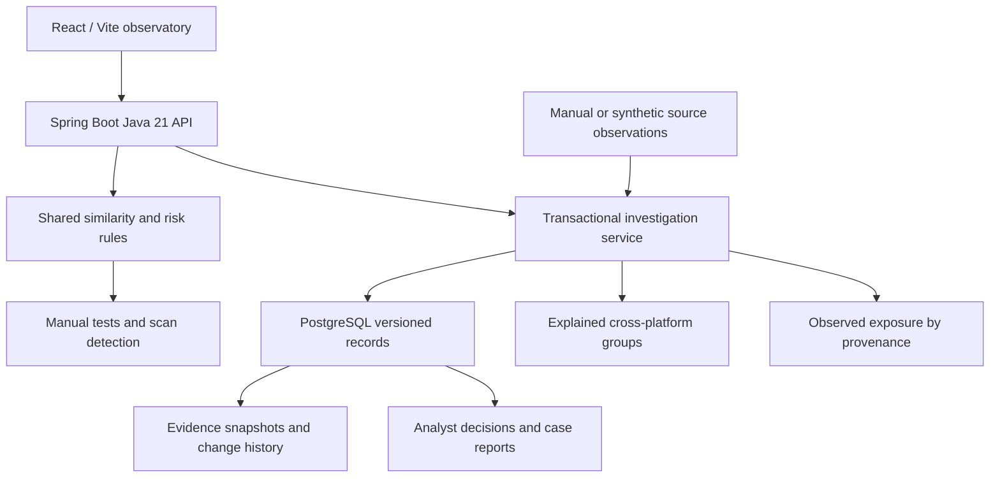

# Digital Threat Observatory architecture

## Persistence relationships

`brandId` ties official assets and candidates to the brand registry. Candidate identities are stable within brand, platform, identifier and provenance; designated demo seeds have an isolated resettable namespace. Evidence has `candidateId` and a scan identifier for imported observations, plus the metadata at ingestion time. Cases and decisions reference stable candidate IDs. Reports gather candidate state, observation snapshots and the append-only decision audit.

PostgreSQL rows in `observatory_records`: `id`, `kind`, `demo_seed`, `payload` (SQL text JSON), and optimistic-lock `version`. Supported kinds: brand, asset, candidate, evidence, scan, decision, case and resetAudit. The legacy URL tables are retained. Text JSON is portable across isolated H2 tests and PostgreSQL runtime. SQL relationships within these documents are validated by the service, not database foreign keys; schema migrations and relational normalization are future production work.

No live source, screenshot or ownership connector exists. The browser never computes substitute results. Screenshots are unavailable; stored URLs are never fetched by these API routes. Manual tests use the same Java normalization/Levenshtein function as imported scan detection but do not persist a finding. API failures appear in the UI.

## Safe reset boundary

Only the seeded fictional NovaBank brand, two assets, three candidates and three original evidence snapshots carry `demoSeed=true`. User imports never overwrite those seed records, even if they use the same stable identifier. Reset deletes this designated set transactionally, restores it and writes a non-resettable audit event. All analyst decisions, cases, imported observations and user-created synthetic records are preserved.

## Local network

- Browser → Vite dev proxy → Java API → PostgreSQL, when using local tooling.
- Browser → Nginx → Java container → PostgreSQL container, when using Compose.
- Compose exposes 5173, 8080 and 5432 on loopback only.
- Backend CORS permits the documented localhost frontend origins.
